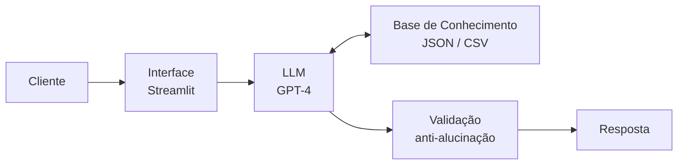

# 🤖 Dionísio — Agente Financeiro com IA Generativa

Projeto do **Bootcamp Bradesco – GenAI & Dados**, da **DIO (Digital Innovation One)**.

O **Dionísio** é o planejamento de um **agente financeiro inteligente**: um assistente que tira dúvidas de clientes sobre investimentos, transferências e finanças pessoais, respondendo **com base nos dados do próprio cliente** e sem inventar informações.

> **Agente de IA** é um assistente que, além de conversar, **consulta dados** e segue **regras** antes de responder. É diferente de um chat comum, que responde só com o que "sabe" de forma geral.

---

## 📍 Contexto

O laboratório propôs **projetar um agente de IA para o setor financeiro**, documentando cada decisão: o problema, a persona, a arquitetura, a base de dados, os prompts, os testes e o pitch.

## ❗ Problema

Clientes de banco têm dúvidas frequentes ("quanto gastei este mês?", "onde posso investir?"), e as respostas genéricas da internet **não levam em conta a situação de cada um**. Além disso, IAs genéricas podem **alucinar**, ou seja, inventar informações com confiança, o que é perigoso quando o assunto é dinheiro.

## 🛠️ Solução (o que e como fiz)

Projetei o agente em camadas, onde a IA **sempre consulta os dados antes de responder** e a resposta passa por uma **validação**:



| Componente | Função |
|---|---|
| **Interface** (Streamlit) | Tela de chat onde o cliente escreve |
| **LLM** (GPT-4 via API) | O "cérebro" que entende a pergunta e monta a resposta |
| **Base de Conhecimento** | Dados do cliente: perfil de investidor, transações, produtos e histórico |
| **Validação** | Confere se a resposta se apoia nos dados, sem invenção |

**Persona do agente:**

- **Nome:** Dionísio
- **Personalidade:** respeitoso, direto e didático
- **Tom:** acessível
- **Exemplo:** *"Olá! Como posso ajudar?"*
- **Quando não sabe:** *"Não tenho informações sobre isso no momento, mas posso te ajudar com outra coisa."*

**Regras de segurança:**

- responde **apenas com base nos dados fornecidos**;
- **admite quando não sabe**, em vez de inventar;
- **não recomenda investimentos** sem conhecer o perfil do cliente;
- não compartilha dados de outros clientes.

**Analogia:** o Dionísio funciona como um **gerente de banco** que, antes de responder, **abre a ficha do cliente**. Ele não chuta: se a informação não está na ficha, ele diz que não sabe.

## 📊 Resultado esperado (Antes × Depois)

| Antes (chat genérico) | Depois (Dionísio) |
|---|---|
| Respostas iguais para todo mundo | Respostas baseadas no perfil e nas transações do cliente |
| Pode inventar dados financeiros | Só responde com o que está na base de dados |
| Recomenda investimentos sem critério | Exige o perfil de investidor antes de recomendar |
| Responde qualquer assunto | Foca em finanças e redireciona o que está fora do escopo |

---

## 📂 Estrutura do repositório

```
lab-agente-financeiro/
└── documentacao/
    ├── DionisioAgente.md         → caso de uso, persona e arquitetura
    ├── base-de-conhecimento.md   → dados usados e como entram no prompt
    ├── prompt.md                 → system prompt e exemplos de conversa
    ├── teste.md                  → métricas e cenários de teste
    └── pitch.md                  → roteiro da apresentação (3 min)
```

## 🧪 Como o agente será avaliado

| Métrica | O que avalia | Exemplo |
|---|---|---|
| **Assertividade** | Respondeu o que foi perguntado? | Perguntar o saldo e receber o valor correto |
| **Segurança** | Evitou inventar? | Pergunta fora do escopo, e ele admite que não sabe |
| **Coerência** | Faz sentido para o perfil? | Sugerir investimento conservador para cliente conservador |

## 🚧 Status

Projeto em **fase de documentação e planejamento**. Próximos passos:

- [ ] Escrever o *system prompt* completo
- [ ] Adicionar a pasta `data/` com os arquivos de exemplo
- [ ] Implementar o chat em Streamlit
- [ ] Executar os testes e registrar os resultados
- [ ] Gravar o pitch

## 🧰 Tecnologias previstas

Python · Streamlit · OpenAI API (GPT-4) · JSON / CSV · Mermaid
